# BUNI INDUSTRIES
## Selected work. Public history. A continuing build.

Buni Industries brings together creative media, software experiments and interactive storytelling. This portfolio traces the work from early automation projects to Buni Media Hub, the public analytics terminal and current game development.

[Explore the projects](docs/projects.md) · [Read the timeline](docs/history.md) · [Sources and status](docs/sources.md)

## Picture gallery

Selected branding, factory-world illustrations, character stories and visual-novel art, shared for this portfolio. Click a picture to open it.

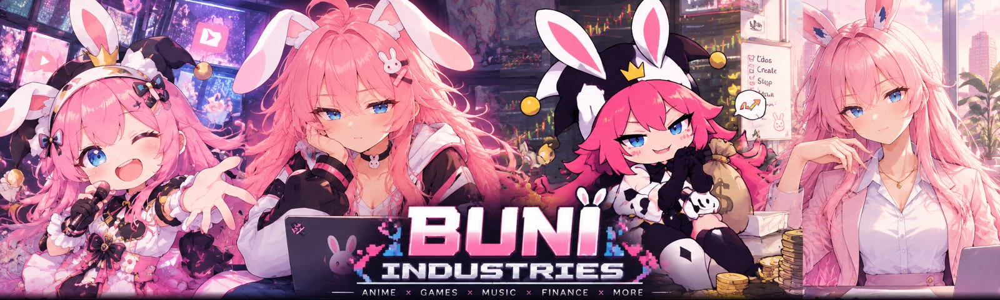

| The creative factory | At the controls |
| --- | --- |
| [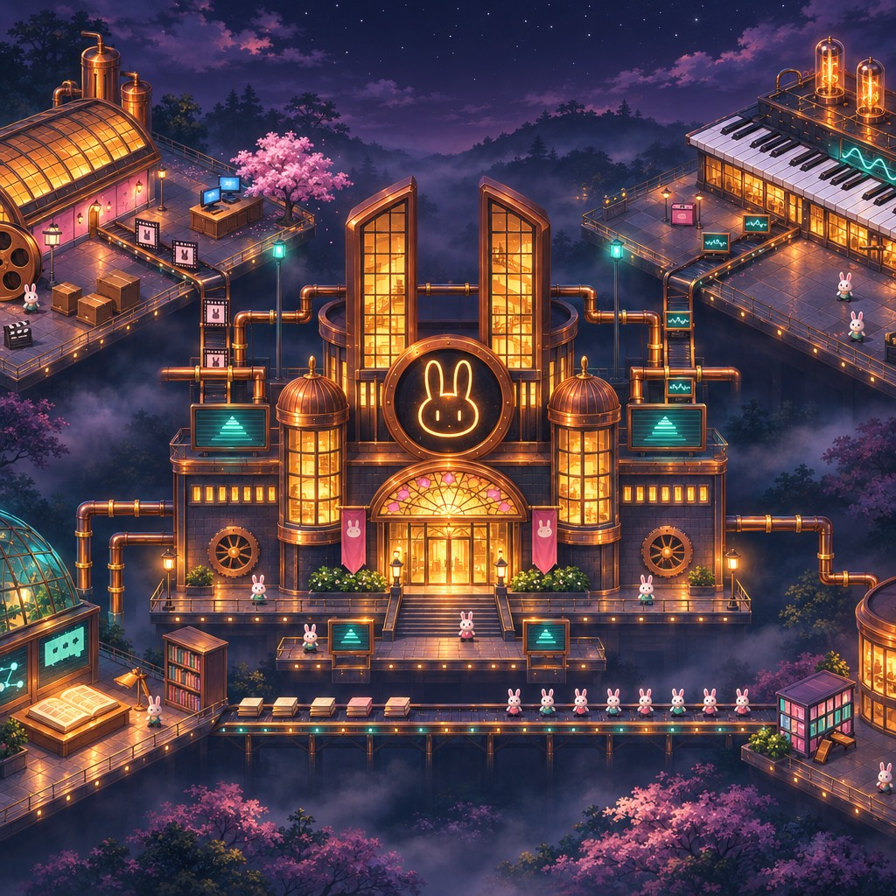](assets/gallery/factory-1.jpg) | [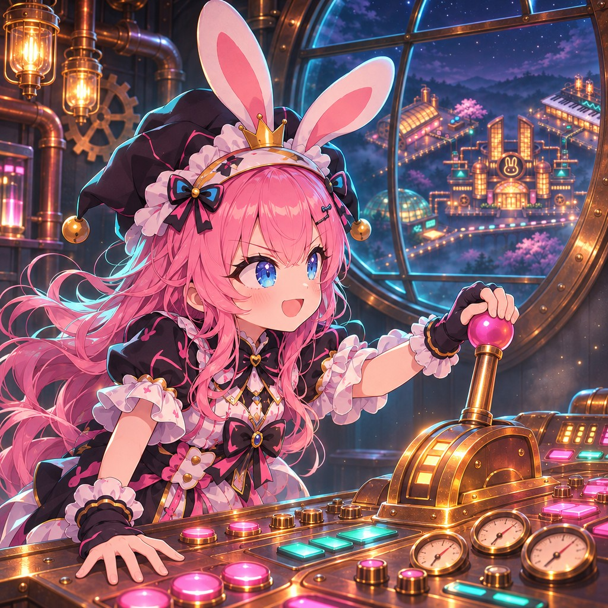](assets/gallery/factory-2.jpg) |
| **A world built around making things** | **Character-led storytelling** |

| The factory grows | A moment to celebrate |
| --- | --- |
| [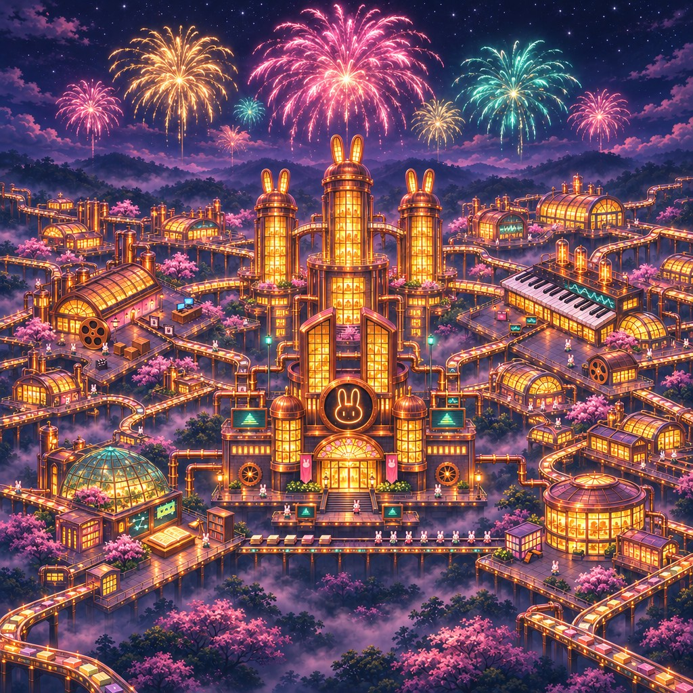](assets/gallery/factory-3.jpg) | [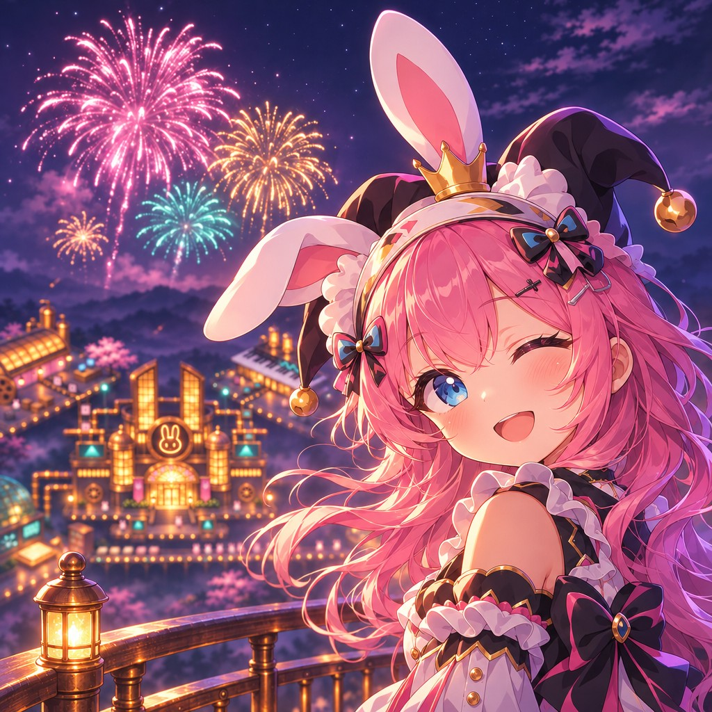](assets/gallery/factory-4.jpg) |
| **Music, animation and playful worldbuilding** | **Buni's visual identity** |

### Malfoid series · fan/adaptation work

Visual storytelling and thumbnail design from **I Love You**. This is unofficial fan/adaptation work, not an official franchise release.

| I Love You | I Meant to Say That |
| --- | --- |
| 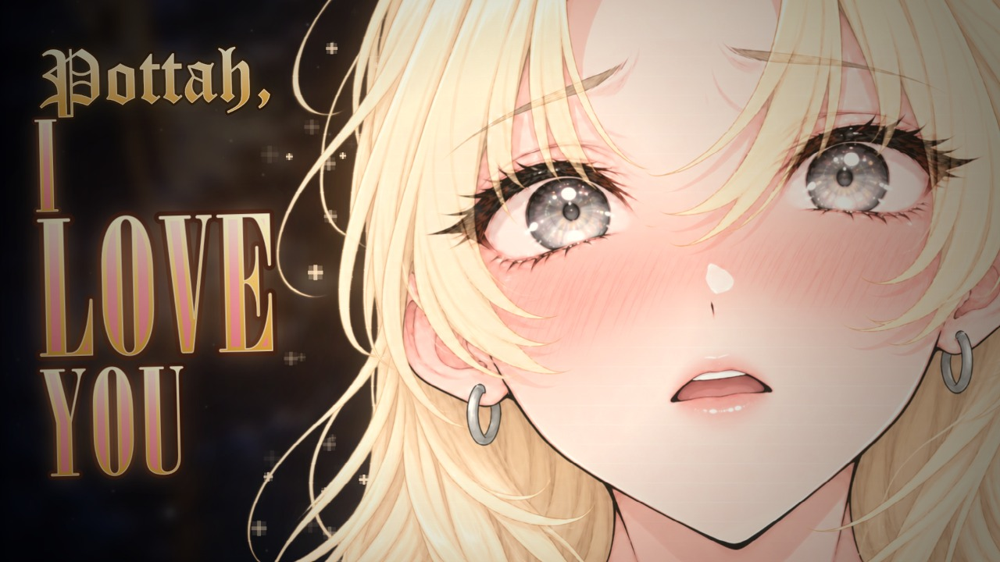 | 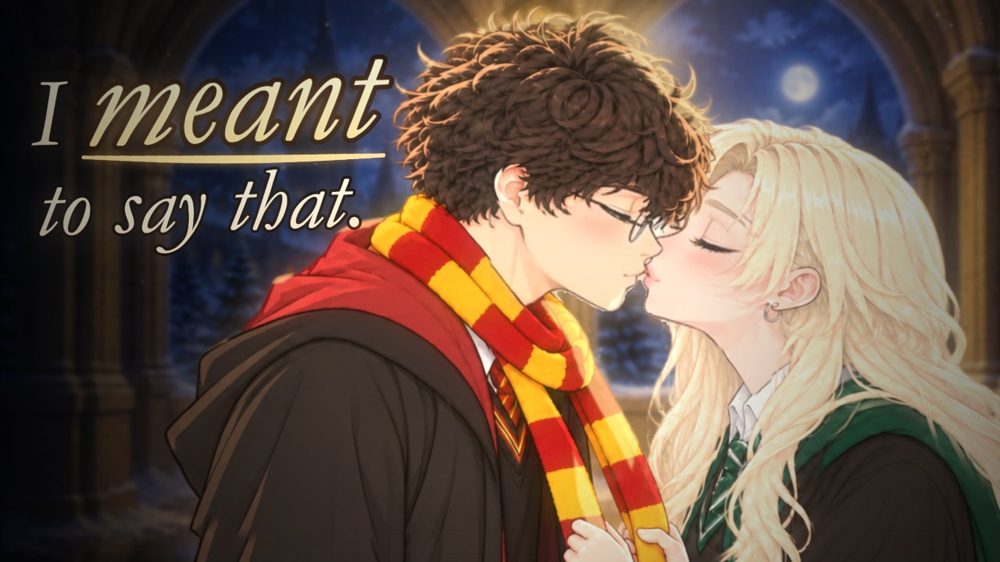 |

### Wolf Mama · character storytelling

Selected **Save a Little Love for Me** project thumbnails: affection, family and a warm visual tone. Shown as Buni's creative interpretation; no claim of exclusive ownership of an underlying character or of an official licence is made here.

| Save a Little Love for Me | There's Room for You |
| --- | --- |
| 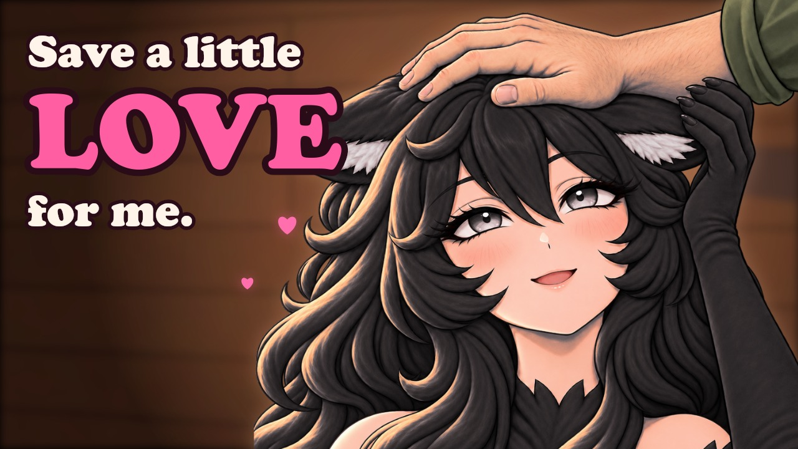 | 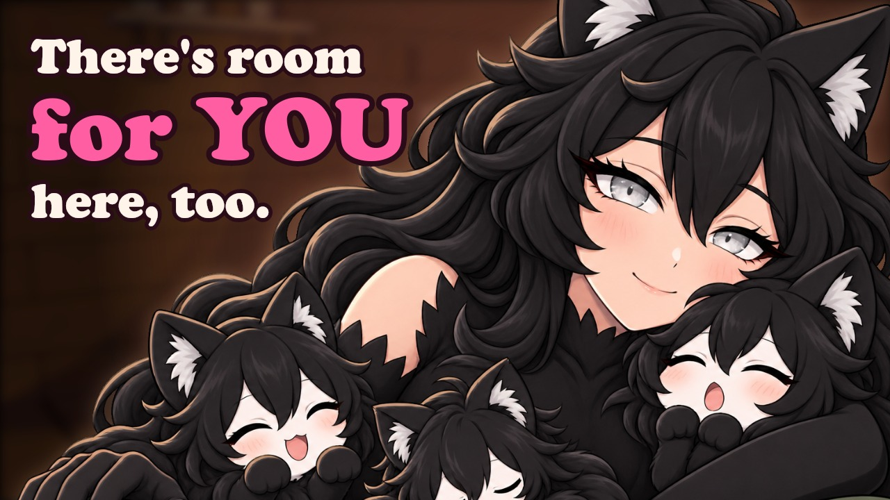 |

### POTTAH! interactive VN · in development

Story and promotional artwork from the **After Graduation** and **The Last Promise** narrative material. These images show the visual direction, **not screenshots of the current Godot build**. For verified engineering progress and limitations, see the [game portfolio](https://github.com/Absurdsenapiii/buni-game-portfolio).

| After Graduation | The Last Promise |
| --- | --- |
| 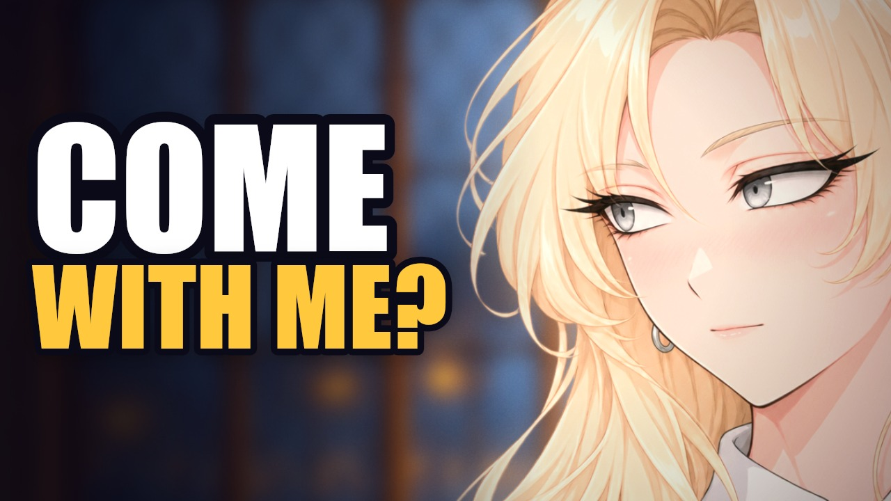 | 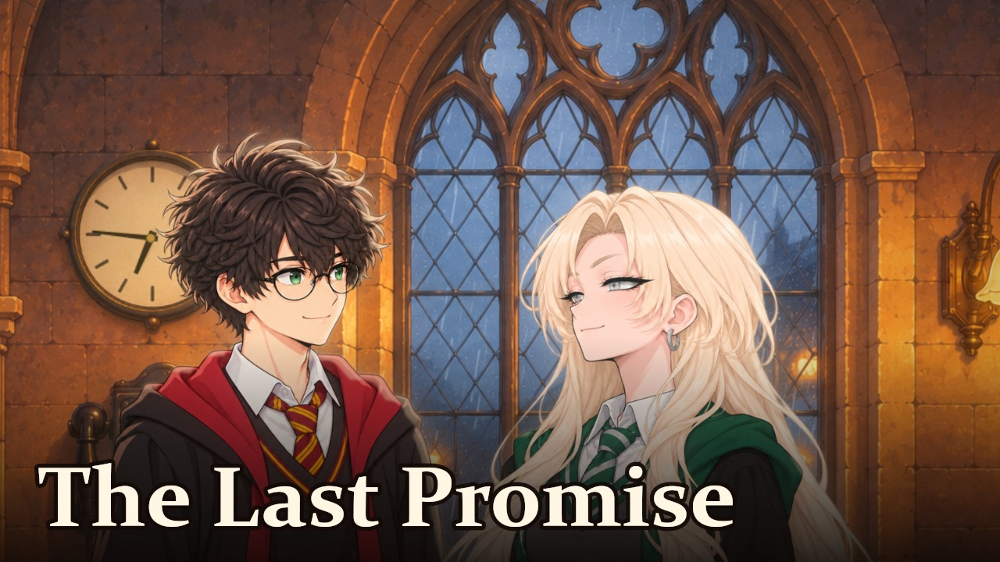 |

The Malfoid and POTTAH material is unofficial fan/adaptation work. Referenced franchises and third-party characters belong to their respective rights holders. This portfolio does not imply affiliation, endorsement or licensing.

[Gallery notes and image context](docs/gallery.md).

## Selected projects

| Project | What to explore | Status |
| --- | --- | --- |
| **Buni public analytics** | A public YouTube-data collector with source code and automated tests | Active integration documented |
| **POTTAH! game** | Godot narrative-game systems, testing and an honest development record | In development |
| **Early automation** | Python and JavaScript alerting, monitoring and blockchain experiments | Historical archive |
| **Buni Media Hub** | The creative transition toward music, animation and character storytelling | Current creative direction |

### Public analytics
The [YouTube collector](https://github.com/Absurdsenapiii/buni-youtube-collector) reads public channel and video counts for the Buni terminal. Its repository contains implementation, tests and operational documentation. It is distinct from private owner analytics.

### Interactive storytelling
The [game portfolio](https://github.com/Absurdsenapiii/buni-game-portfolio) presents the POTTAH! Godot prototype: branching dialogue, persistent story state, save recovery, replay-aware interactions and audio controls. It separates developer-reported tests from independently reproduced checks. The game is not a finished release.

### Where it started
[Past History Projects](https://github.com/Absurdsenapiii/Past_History_Projects) preserves early software experiments, including a market-alert bot and a read-only transfer watcher.

This archive shows the work as it existed, including drafts and unfinished ideas. Its contents are not presented as audited or supported products.

## A short history

- **November 2025:** the early-project repository was created. This is an archive date, not claims about when every experiment began.
- **November 2026:** the public YouTube collector records its activation, while narrative-game development continues in Godot.

The [timeline](docs/history.md) connects each entry to its source.

## How to read this portfolio

Every project has a status. A published repository proves that material is available, not that every historical claim or program has been independently validated.

Private production systems, credentials, unreleased production packages and private analytics are not included. Linked projects retain their own licences and restrictions.

**Last reviewed: 12 November 2026.**
